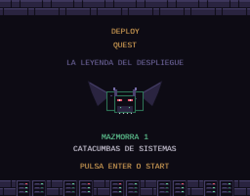

# Deploy Quest

Aventura de 8 bits con vista cenital: un desarrollador, armado con su teclado y su Escudo de IaC, recorre las Catacumbas de Sistemas para recuperar la primera página del Grimorio de la Definition of Done.

Es un único archivo HTML con canvas y JavaScript, sin dependencias ni compilación. Se juega en el navegador, con teclado o con los mandos táctiles en el móvil.

| | |
|---|---|
|  |  |

## Jugar

Abre [`index.html`](index.html) en el navegador.

Con GitHub Pages activado, el juego queda en `https://serbenda.github.io/deploy-quest/`.

## La mazmorra

Las Catacumbas de Sistemas tienen seis salas:

1. **Vestíbulo del Cron:** la entrada, con bugs.
2. **Sala de las Fugas:** slimes de fuga de memoria que se dividen al reventar. Al limpiarla aparece la credencial.
3. **Cruce de los Logs:** la puerta oeste se abre con la credencial.
4. **Archivo de Terminales:** procesos zombi que se levantan si no los rematas. Al limpiarla aparece la Terminal SSH.
5. **Abismo de los Nodos:** gremlins del ClickOps han borrado a mano el nodo del otro lado. Haz `plan` y `apply` con el Escudo de IaC y cruza con el SSH hasta la Llave Root.
6. **Cámara del AS/400:** el Dragón Negro. Cuando abre la boca deja el puerto 22 abierto: aturdido con el SSH, es vulnerable al teclado.

Al vencerlo recuperas la página **Logs y trazas** del Grimorio, con el hechizo *Revelar* para descubrir una sala secreta.

## Controles

| Tecla | Acción |
|---|---|
| Flechas / WASD | Moverse |
| Z · J · Espacio | Golpe de teclado, leer carteles |
| X · K | Terminal SSH |
| C · L | Escudo de IaC: mantener para `plan`, soltar para `apply` |
| Enter | Empezar, pasar textos y abrir el Grimorio |
| M | Silenciar |

Cada golpe tira un d20: con un 20 haces crítico y con un 1 pifias.

## Otros juegos

¿Te va más el beat 'em up? [Dungeons & Deployments](https://github.com/serbenda/dungeons-and-deployments) es la edición recreativa, con el Guerrero de Rundeck y el Mago Desarrollador.
